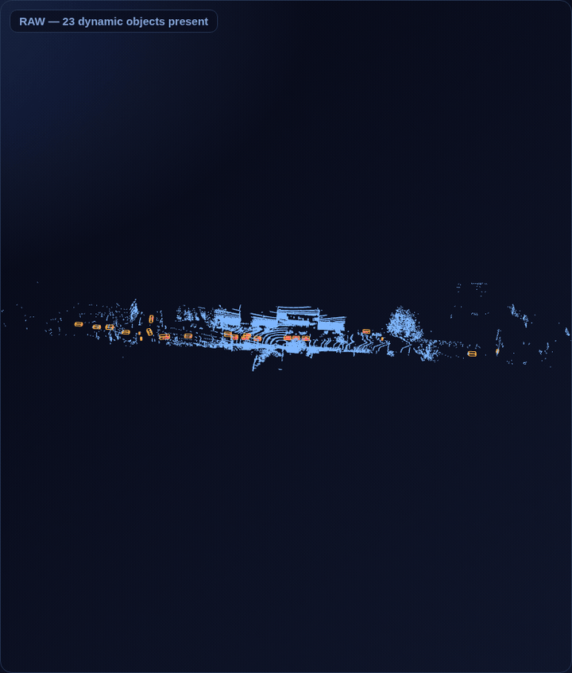
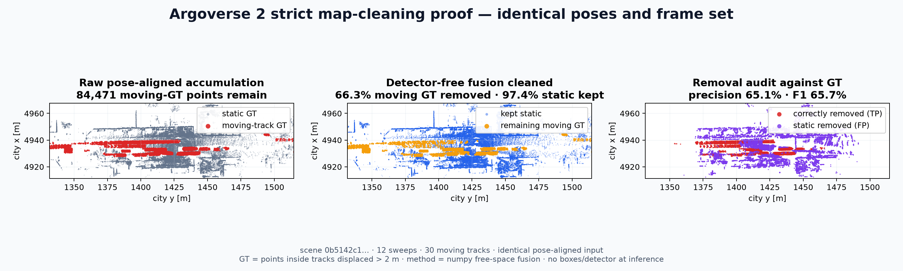
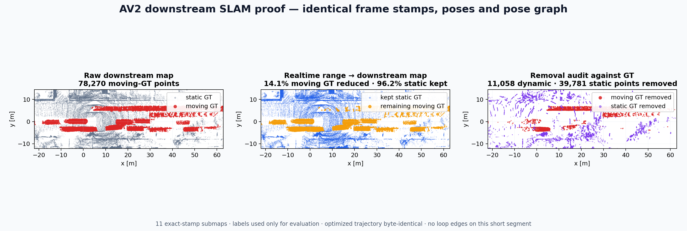

# Dynamic 3D Object Removal

[](https://github.com/rsasaki0109/dynamic-3d-object-removal/actions/workflows/test.yml)
[](https://rsasaki0109.github.io/dynamic-3d-object-removal/demo/playground.html)
[](https://github.com/rsasaki0109/dynamic-3d-object-removal/releases)

> **Keep moving objects from becoming LiDAR map ghosts.**

Detector-free, CPU-only LiDAR map cleaning and pose-aware ROS2 filtering. NumPy is the only required dependency. Try the real implementation in your browser — no GPU, upload, or signup.

[Browser playground](https://rsasaki0109.github.io/dynamic-3d-object-removal/demo/playground.html) · [Clean your first map](examples/quickstart/README.md) · [ROS2](#ros2-realtime) · [Accuracy proof](#av2-detector-free-proof)

[](https://rsasaki0109.github.io/dynamic-3d-object-removal/demo/playground.html)

## Choose your path

| Task | Start with |
|---|---|
| Dense, pose-aligned offline map (64-beam class) | `fusion` |
| Sparse offline map (32-beam) | `range_scan_ratio`: remove only where both methods agree |
| Moving-platform ROS2 stream | `range` or `temporal`, timestamped TF, deskewed input |
| Per-scan removal with existing 3D boxes | `box` |
| Preview without installing | [Browser playground](https://rsasaki0109.github.io/dynamic-3d-object-removal/demo/playground.html) |



Same-pose AV2 proof: detector-free `fusion` removes **66.3%** of moving GT and keeps **97.4%** of static GT. Boxes provide evaluation labels only.

## Install

```bash
pip install dynamic-object-removal
```

Start with the [download-free first-map guide](examples/quickstart/README.md), or clean a scan using 3D boxes:

```bash
dynamic-object-removal \
  --input-cloud scan.pcd --input-objects objects.json \
  --output-cloud cleaned.pcd
```

### Clean a map using multiple scans

For about 12 dense, pose-aligned scans:

```bash
dynamic-object-removal \
  --algorithm fusion --preset short-window \
  --input-map map.npy --input-manifest scans.json \
  --output-cloud output/cleaned.npy --output-mask output/keep.npy \
  --summary-json output/summary.json
```

The manifest supplies scans, poses/sensor origins, and explicit deskew metadata. The CLI does not estimate poses or deskew scans. Use `long-map` for long dense sequences; sparse 32-beam maps should use `--algorithm range_scan_ratio` and range resolution matched to beam density.

[Manifest, presets, and CLI options](docs/usage.md#clean-a-map-using-multiple-scans) · [Sparse-map workflow](docs/usage.md#clean-a-sparse-map-with-range--scan-ratio)

## Algorithms

| Method | Evidence | Needs boxes |
|---|---|---|
| `box` | Per-scan 3D-box crop | yes |
| `temporal` | Streaming voxel consistency; optional visibility gate | no |
| `range` | Range-image visibility + surface revert | no |
| `scan_ratio` | Polar-column occupancy + ground revert | no |
| `fusion` | Offline free-space + void + scan-ratio fusion | no |
| `range_scan_ratio` | CLI intersection of range and scan-ratio dynamic masks | no |

Moving sensors require aligned poses for detector-free filtering. [API and algorithm details](docs/api-and-demos.md).

## How It Compares

Unlike the C++/ROS/PCL-based [ERASOR](https://github.com/LimHyungTae/ERASOR) and [Removert](https://github.com/gisbi-kim/removert) offline cleaners, this NumPy library also provides online scan filtering. The following are this project's measurements, not head-to-head reruns.

| Dataset | Method | F1 | Static kept |
|---|---|---:|---:|
| AV2, 64-beam, 3-scene mean | `fusion`, short-window thresholds | 0.642 | 96.4% |
| nuScenes mini, 32-beam, 6-scene eligible mean | `range ∩ scan_ratio` | 0.240 | 93.1% |

Semantic-KITTI DynamicMap: `fusion` AA **98.6 / 98.0** on sequences 00 / 05. nuScenes means exclude scenes with fewer than 5,000 moving-GT points. [Full tables, conditions, and reproduction](docs/benchmarks.md).

### AV2 detector-free proof


Historical audited snapshot: **12 sweeps**, **1,235,563 points**, **84,471 moving-GT points**. This single-scene result is separate from the means above. [Configuration and counts](demo/av2_gt_map_proof.json).

The separate [20-frame AV2 demo](https://rsasaki0109.github.io/dynamic-3d-object-removal/demo/index_3d_sequence_av2.html) uses annotation-box crops, including parked objects; it is a visual preview rather than detector-free accuracy evidence.

## ROS2 Realtime

```bash
dynamic-object-removal-realtime \
  --pointcloud-topic /velodyne_points --output-topic /cleaned_points \
  --algorithm range --fixed-frame odom --range-window 3 \
  --expected-rate-hz 10 --summary-json dor_summary.json
```

Moving-platform `range`/`temporal` require timestamped TF and deskewed input. Missing, invalid, or stale TF publishes the scan unchanged and excludes it from history. [ROS2 options](docs/usage.md#ros2-realtime) · [Online benchmark](scripts/run_online_benchmark.py).

## Downstream SLAM Proof



With **11 identical cloud/odometry pairs** and byte-identical trajectories, realtime `range` reduces moving-GT map points by **14.1%**, keeps **96.2%** of static GT, and achieves **21.8%** removed-point precision. This is integration evidence, distinct from offline accuracy. [Experimental lidarslam_ros2 integration](examples/lidarslam_ros2/README.md).

## Python API

```python
from pathlib import Path
from dynamic_object_removal import load_points, load_boxes, remove_points_in_boxes, save_points

points = load_points(Path("scan.pcd"), fmt="auto")
boxes = load_boxes(Path("objects.json"), fmt="auto")
cleaned, keep = remove_points_in_boxes(points, boxes)
save_points(Path("cleaned.pcd"), cleaned, fmt="auto")
```

Supports PCD (ASCII/binary), CSV, TXT, XYZ, NPY, KITTI BIN, and AV2 Feather; compressed PCD is unsupported. Feather input requires `pyarrow`. [Full API](docs/api-and-demos.md#python-api).

## Documentation and demos

- [CLI, manifests, presets, and public-data quick start](docs/usage.md)
- [Benchmarks, regression comparison, and API/CLI validation](docs/benchmarks.md)
- [Python API and demo regeneration](docs/api-and-demos.md)
- [Single-scan demo](https://rsasaki0109.github.io/dynamic-3d-object-removal/demo/index_3d_standalone.html) · [Local sequence](https://rsasaki0109.github.io/dynamic-3d-object-removal/demo/index_3d_sequence_standalone.html)
- [Real-data validation records](examples/cli_validation/README.md) · [Changelog](CHANGELOG.md)
- Related work: [UTS-RI/dynamic_object_detection](https://github.com/UTS-RI/dynamic_object_detection)
